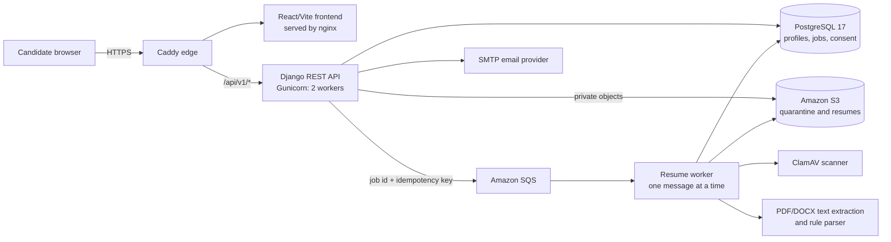

# ENTER Candidate Platform — Backend Guide

This guide explains what ENTER does **today**, in beginner-friendly language. It is based on
the source code in this repository and a small set of read-only checks against
`https://enter.careers` on 23 October 2026.

## How to read status labels

| Label | Meaning |
| --- | --- |
| **Production-confirmed** | Observed through a safe, public production endpoint. |
| **Production configuration** | Required or selected by the production Compose/configuration files. It may still need an infrastructure check. |
| **Code default** | The value used when an environment variable does not override it. |
| **Implemented but disabled** | Code exists, but a production gate prevents it from being used. |
| **Not freshly verified** | The repository contains a design, script or earlier measurement, but the live AWS resource was not inspected during this review. |

The public checks confirmed that the application and database were ready, the resume queue
reported `sqs`, published legal documents were enabled, and recruiter project routes returned
404 in candidate-only production. They did **not** reveal EC2 instance type, S3 bucket settings,
DLQ attributes, backup schedules or secret environment values. See
`backend/talent/views.py:118-144 (readiness)` and `backend/talent/launch_controls.py`.

## 1. Backend architecture

Production is designed as a single-host Docker Compose stack. Caddy terminates HTTPS and
routes browser requests. nginx serves the React frontend. Django REST Framework supplies JSON
APIs. PostgreSQL stores users, profiles, work history, consent evidence, rate-limit buckets and
durable resume jobs. S3 stores private files; SQS wakes the worker; ClamAV scans each upload.
The frontend calls `/api/v1` with cookies and CSRF protection.

Sources: `compose.production.yaml:1-160`, `deploy/Caddyfile:1-32`,
`backend/config/settings.py:32-44,77-83,102-152,195-242,475-502`,
`frontend/src/api.ts:7-62`.

### Main components

| Component | Responsibility | Technology | Main evidence |
| --- | --- | --- | --- |
| Edge | HTTPS, security headers, body-size limits, routing | Caddy | `deploy/Caddyfile:1-32` |
| Frontend | Signup, upload, profile review and submission UI | React, TypeScript, Vite, nginx | `frontend/src/App.tsx`; `frontend/src/api.ts:7-106` |
| API | Validation, authentication, ownership and business rules | Python 3.12, Django 5.2, DRF | `pyproject.toml`; `backend/config/settings.py:32-83` |
| Database | Accounts, profiles, resumes, jobs, consent and recruiter data | PostgreSQL 17 | `backend/talent/models.py`; `compose.production.yaml:45-65` |
| Private file storage | Quarantined uploads, clean resumes and photos | S3 via `django-storages` | `backend/config/settings.py:126-152` |
| Queue | Durable notification that a resume job is ready | Amazon SQS | `backend/talent/resume_processing.py:88-164` |
| Worker | Scan, extract, parse, merge and retry resume data | Django management worker | `backend/talent/resume_processing.py:167-516`; `backend/talent/worker_runtime.py` |
| Malware scanner | Streams each file through ClamAV before parsing | ClamAV daemon | `backend/talent/resume_processing.py:51-85` |
| Email | Verification and password-reset messages | Django SMTP backend | `backend/talent/account_security.py`; `backend/config/settings.py:257-292` |

There is one product Django application, `talent`. Its files are separated by concern rather
than by many Django apps: models in `models.py`, API routes in `urls.py`, API views in
`views.py`/`candidate_views.py`, serializers and validation in `serializers.py`, parsing in
`services.py`, queue work in `resume_processing.py`, and legal/retention code in `legal.py` and
the management commands.

### Important database records

| Model | What it stores | Source |
| --- | --- | --- |
| `User`, `UserRole` | Django login plus candidate/recruiter role | `backend/talent/models.py:19-25` |
| `CandidateProfile` | Candidate identity, headline, location, experience, pay, preferences, skills, education and submission state | `backend/talent/models.py:56-119` |
| `WorkExperience` | Role, company, dates, description and manual gap reason | `backend/talent/models.py:217-230` |
| `Resume` | Private file key, version, scan/processing states and internal extracted JSON | `backend/talent/models.py:233-270` |
| `ResumeProcessingJob` | Durable state, idempotency key, attempt count and queue message | `backend/talent/models.py:277-305` |
| `LegalAcceptance` | Exact accepted document text, version, hash and timestamp | `backend/talent/models.py:122-136` |
| `RateLimitBucket` | Shared PostgreSQL-backed request counters | `backend/talent/models.py:330-337` |
| Recruiter models | Approval, saved searches, projects, stages, views and notifications | `backend/talent/models.py:44-53,340+` |

## 2. Candidate journey: signup to final submission

1. **Signup.** The API accepts candidate accounts only. It validates email uniqueness,
   password strength, the allowed country, and—when the published legal workflow is enabled—
   age and terms acceptance. It creates an inactive user and candidate profile.
   `backend/talent/views.py:155-207 (signup)`;
   `backend/talent/serializers.py:26-56 (SignupSerializer)`.
2. **Email verification.** A one-use random token is stored only as a SHA-256 hash. The emailed
   token expires after 24 hours by default. Successful verification activates the account and
   sets `email_verified_at`. Login is blocked until then.
   `backend/talent/account_security.py`; `backend/talent/views.py:210-333`;
   `backend/config/settings.py:295-304`.
3. **Resume upload.** A verified candidate with current terms uploads a PDF or DOCX. The API
   checks extension, file signature and size, saves it under a private quarantine key, creates
   a versioned `Resume` and a durable PostgreSQL job, then tries to publish the job to SQS.
   `backend/talent/views.py:557-620 (resume_upload)`.
4. **Malware scan.** The worker streams the private object to ClamAV. Only a clean file is moved
   from quarantine to its normal private resume key.
   `backend/talent/resume_processing.py:51-75,409-433`.
5. **Extraction and parsing.** `pypdf` or `python-docx` extracts text. `parse_resume()` uses
   regular expressions, headings, date patterns and fixed keyword lists. Production Compose
   explicitly disables external AI.
   `backend/talent/services.py:86-123,320-469`;
   `compose.production.yaml:11-23`.
6. **Safe merge.** The first resume can populate empty profile data. A replacement does not
   overwrite fields the candidate edited; conflicts become review proposals. Missing extracted
   values never clear saved values. Replacement resumes must have the same normalized name
   tokens or their data is blocked from merging.
   `backend/talent/resume_processing.py:235-326`;
   `backend/talent/candidate_experience.py:51-124`.
7. **Candidate review/edit.** The candidate can edit the profile, skills, work history, career
   settings and parsed proposals. These edits are recorded so later resumes do not silently
   replace them. `backend/talent/views.py:413-466 (candidate_profile)`;
   `backend/talent/serializers.py:117-557`.
8. **Submission.** The API requires a clean completed resume plus required profile fields and
   current submission acceptance. The profile becomes `submitted` and legal evidence is
   recorded. In current candidate-only/legal production, submission is **not** treated as
   permission for recruiters to see the candidate.
   `backend/talent/views.py:469-521 (submit_candidate_profile)`;
   `backend/talent/serializers.py:419-475`.

### What happens when a step fails

| Failure | Result and recovery | Evidence |
| --- | --- | --- |
| Verification email cannot be sent | Account remains created but inactive; API returns 503 and tells the candidate to resend | `backend/talent/views.py:188-200` |
| Expired/used verification or reset token | Token is rejected; candidate requests a new one | `backend/talent/account_security.py` |
| Invalid upload | Rejected before storage/job creation with a 400 response | `backend/talent/views.py:565-587` |
| SQS publish is unavailable | Upload still has a durable DB job; the dispatcher can publish it later | `backend/talent/views.py:602-616`; `resume_processing.py:134-164` |
| ClamAV unavailable | Job is requeued, then fails after the attempt limit | `resume_processing.py:355-406,509-512` |
| Malware found | Resume is marked `infected`; retry is forbidden and a different file is required | `resume_processing.py:490-508`; `views.py:626-641` |
| No readable text/parser error | Generic safe error, retry with backoff, terminal failure after maximum attempts | `resume_processing.py:434-437,513-516` |
| Worker dies or exceeds limits | Lease/visibility timeout allows redelivery; bounded child process is retried | `resume_processing.py:167-217`; `worker_runtime.py:32-67` |
| Replacement name differs/is missing | Extraction remains stored internally, but profile merge is blocked | `candidate_experience.py:103-124`; `resume_processing.py:235-242` |
| Required profile data is missing | Submission returns 400 with `missing_fields`; profile remains draft | `views.py:479-489`; `serializers.py:449-475` |

## 3. Registration, upload and submission filters

### Registration and account rules

| Rule | Exact behavior/default | Production status | Evidence |
| --- | --- | --- | --- |
| Candidate only | Public signup rejects `recruiter`; recruiter creation is administrator-controlled | Active | `views.py:165-168`; `serializers.py:30` |
| Country | Self-declared ISO code. Production code defaults to and approved launch requires exactly `IN`; it is not proof of physical location | Active configuration | `settings.py:383-392,459-462`; `serializers.py:39-50` |
| Age | Candidate must self-confirm being at least 18; no date of birth or automated age calculation is implemented | Active when legal flow is enabled | `views.py:162-164`; `legal.py`; `deploy/PRIVACY_POLICY_PUBLICATION.txt:165` |
| Duplicate email | Case-insensitive duplicate `username` is rejected | Active | `serializers.py:34-37` |
| Password | Minimum 8 at serializer plus Django similarity, common, numeric and minimum-length validators | Active | `serializers.py:28,51-55`; `settings.py:85-90` |
| Email verification | User starts inactive; verified active candidate required for candidate APIs | Active | `views.py:173-185`; `permissions.py:7-17` |
| Session | DRF token in Secure cookie, CSRF on cookie-authenticated unsafe requests; default lifetime 7 days | Active; TTL is configurable | `authentication.py:23-46`; `settings.py:118-124,304` |
| Verification/reset expiry | Verification 86,400 seconds; reset 3,600 seconds; resend cooldown 60 seconds | Code defaults | `settings.py:295-304` |
| Rate limits | Signup 5/hour/IP; login 10/min/IP; resend 5/hour/IP; verification consume 60/hour/IP; reset request 5/hour/IP; reset confirm 30/hour/IP | Production defaults; environment can override | `settings.py:480-497`; `throttling.py` |
| Pause switch | Registration can fail closed through `CANDIDATE_REGISTRATION_PAUSED` | Implemented; live value not exposed | `settings.py:378-380`; `launch_controls.py` |

Rate limits use PostgreSQL, so both Gunicorn workers share one counter. Public endpoints key by
observed IP; authenticated endpoints key by user. This means many people behind one corporate
NAT may share the signup limit. `backend/talent/throttling.py:11-69`.

### Resume upload and processing rules

| Rule | Exact behavior/default | Production status | Evidence |
| --- | --- | --- | --- |
| Permission | Verified candidate plus current terms | Active | `views.py:557-565`; `permissions.py:45-47` |
| Formats | `.pdf` and `.docx` only | Active | `views.py:568-573` |
| Content signature | PDF must start `%PDF-`; DOCX must start `PK` | Active, lightweight magic check rather than full MIME inspection | `views.py:574-581` |
| File size | 5 MiB application default; edge allows 6 MB multipart body | Active/configurable | `settings.py:293`; `deploy/Caddyfile:14-19` |
| PDF complexity | Maximum 100 pages and 500,000 extracted characters | Active | `services.py:100-114` |
| DOCX complexity | Maximum 2,048 ZIP entries and 40 MiB decompressed content | Active | `services.py:86-97` |
| Malware | Production startup requires `RESUME_SCANNER_BACKEND=clamav`; infected file fails permanently | Active configuration | `settings.py:210-242`; `resume_processing.py:51-75,490-508` |
| Upload rate | 10/hour per authenticated user | Production default/configurable | `settings.py:495-497`; `throttling.py:96-98` |
| Versioning | Each new upload increments version; old records are not treated as duplicates | Active | `views.py:588-604` |
| Replacement merge | Candidate-edited fields are protected; differing proposals require review; missing data never clears saved data | Active | `resume_processing.py:243-326` |
| Retry | Three automatic attempts by default; delays start at 30 then 60 seconds; infected uploads cannot retry | Active/configurable | `settings.py:199-205`; `resume_processing.py:355-406`; `views.py:626-668` |
| Pause switch | Uploads can fail closed through `RESUME_UPLOADS_PAUSED` | Implemented; live value not exposed | `settings.py:381`; `launch_controls.py` |
| OCR | No OCR path exists; image-only/scanned PDFs usually produce no text and fail | Not implemented | `services.py:100-123`; `resume_processing.py:434-437` |

### Profile and submission rules

| Rule | Exact behavior/default | Required to submit? | Evidence |
| --- | --- | --- | --- |
| Clean resume | At least one `completed` + `clean` resume | Yes | `serializers.py:449-468` |
| Current role/headline | Non-empty | Yes | `serializers.py:222-229` |
| Current location | Non-empty | Yes | `serializers.py:230-236` |
| Total experience | Must be greater than zero | Yes | `serializers.py:237-243,429-431` |
| Notice period | Non-null; UI suggestions are 0, 15, 30, 60, 90 days, but serializer stores any non-negative integer supported by the model | Yes | `serializers.py:244-251`; `models.py:75` |
| Skills | Non-empty; up to 100 strings, each up to 240 characters | Yes | `serializers.py:252-258,397-406` |
| Work preferences | One or more of Flexible, Remote, Hybrid, On-site | Yes | `serializers.py:259-266,391-395` |
| Visibility | Normally one of approved recruiters, matching roles or not looking | Treated as satisfied in candidate-only/published-legal mode | `serializers.py:267-274,419-425` |
| Expected pay, links, meaningful work, history, education | Included in completion guidance but only recommended | No | `serializers.py:275-317,438-447` |
| Work dates | End date cannot be earlier than start date | When a row is supplied | `serializers.py:59-64` |
| Career settings | Whitelisted keys; lists max 100; text max 1,000; strongest skills max 5 and must also exist in saved skills | No | `serializers.py:171-219`; `candidate_experience.py:8-29` |
| Build–lead preference | Integer from 0 to 100 | No | `serializers.py:386-389` |
| Consent | Current submission acceptance is recorded. New legal acceptance is not legacy recruiter-sharing consent | Yes | `views.py:475-520`; `models.py:122-136` |

If a submitted candidate later removes a required field, the serializer returns the profile to
draft. `backend/talent/serializers.py:528-557`.

## 4. CV fields: automatic versus manual

Production parsing is deterministic and text-based. Every automatic value can be reviewed and
corrected by the candidate through profile or resume-review APIs. A blank/uncertain extraction
is returned as `""`, `[]` or `null` and does not erase an existing profile value.

| Field | Automatic extraction | Normalization/fallback | Manual? | Evidence |
| --- | --- | --- | --- | --- |
| Full name | `Name:` label, otherwise first non-empty line | Truncated to 180 characters | Yes; replacements also pass same-name guard | `services.py:341,449`; `candidate_experience.py:103-124` |
| Email | First email-shaped regex match | Empty when absent | Yes | `services.py:323,452` |
| Phone | Indian mobile pattern, optional `+91`, first digit 6–9 | Raw matched formatting retained | Yes | `services.py:324,453` |
| Location | `Location:` label, else one of 10 fixed locations in first five lines | Empty when absent | Yes | `services.py:36-46,337-340` |
| Current title | `Role:`/`Title:` if concise, otherwise most recent parsed role | Role must look like a job title | Yes | `services.py:166-173,342,390-393` |
| Current company | `Company:` label, otherwise company on most recent parsed role | Truncated to 180 | Yes | `services.py:343,390-393` |
| LinkedIn/GitHub | URL regex for the exact host | Adds `https://` if missing | Yes | `services.py:131-136,325-326` |
| Skills | Comma-separated `Skills:` plus exact, case-insensitive matches from a fixed 22-item list | De-duplicated, not semantically inferred | Yes | `services.py:10-35,331-336` |
| Work history | Explicit pipe format plus experience-section/date heuristics and `role at company` undated rows | Role/company association required; dates can remain unknown | Yes | `services.py:221-295,345-388` |
| Employment dates | Month name + year, `MM/YYYY`, year-only, and ranges ending Present/Current/Now | Stored as first day of parsed month/year; invalid/unknown stays null | Yes | `services.py:73-83,156-163` |
| Total experience | Explicit phrase such as “8 years of experience” wins; otherwise union of valid dated intervals | Overlaps counted once; undated rows excluded; rounded to 0.1 year | Yes | `services.py:327-330,394-414` |
| Education | `Education:` label and education-section rows containing degree/institution patterns | De-duplicated, maximum 8 parser rows | Yes | `services.py:298-317,389,460` |
| Notice period | Label such as `Notice period: 30 days` | Integer days; null when absent | Yes | `services.py:431,462` |
| Current/expected compensation | Labelled numeric Current/Expected Salary/CTC | Number is treated as LPA; no currency conversion | Yes | `services.py:432-433,463-464` |
| Work setup | Only a labelled Work preferences/Preferred work setup value | Fixed values Flexible/Remote/Hybrid/On-site | Yes | `services.py:434-447,458` |
| Summary | Exact text after `Summary:` | No generated summary | Yes | `services.py:465` |
| Standout signal | `Achievement:` or a qualifying intact achievement sentence | Evidence text only | Yes in career settings | `services.py:415-430,468`; `candidate_experience.py:29` |
| Strongest skills | Ranks extracted skills by occurrences in work descriptions, maximum five | Deterministic derived signal | Yes | `resume_understanding.py:144-150,279-284` |
| Likely directions | Very narrow title-based rule for engineering leadership/staff roles | Deterministic suggestion, not a prediction | Yes | `resume_understanding.py:153-166,279-284` |

The parser does **not** automatically extract or infer employment type, meaningful work,
career-gap reasons, motivators, exclusions, availability, contact preference, preferred
locations, portfolio URL or Build–Lead preference. These are candidate-entered. Employment type
defaults to `Full-time` in the database rather than coming from the CV.
`backend/talent/models.py:78-85,227`; `backend/talent/candidate_experience.py:8-29`.

### Experience and career timeline calculations

- Parsed dated roles become intervals. Intersecting intervals are merged, so overlapping jobs
  count only once toward total experience. An open role ending in Present/Current/Now uses
  today's date. An explicit “N years of experience” sentence overrides this calculation.
- Undated roles are preserved but do not add to total experience. Invalid end-before-start
  ranges are ignored by the parser and rejected on manual editing.
- Career gaps are a **frontend display calculation**, not a saved backend fact. The timeline
  finds the union/latest end of earlier precise roles and displays a gap only when the next role
  starts more than 60 days later. Year-only/coarse dates suppress gap and overlap labels to avoid
  false precision.
- Overlap labels are also UI-only: an earlier precise role must end after the later role starts.
  `gap_reason` is always candidate-entered.

Sources: `backend/talent/services.py:394-414`, `backend/talent/serializers.py:59-64`,
`frontend/src/components/CareerJourney.tsx:61-80`, `backend/talent/models.py:217-227`.

## 5. Recruiter filters that exist but are disabled in production

Recruiter routes and UI code remain in the repository, but production is candidate-only.
`IsRecruiter` rejects access when `CANDIDATE_ONLY` is true, the production frontend hides the
recruiter product, and the public `/api/v1/projects/` check returned 404 during this review.
`backend/talent/permissions.py:20-42`; `compose.production.yaml:136-138`.

If the feature gates were removed, current code implements these filters:

| Filter | Exact current behavior | Source |
| --- | --- | --- |
| Candidate eligibility | Submitted, legacy sharing consent present, visibility set and not `not_looking`; new legal terms/submission candidates are excluded | `views.py:876-886` |
| Location | Case-insensitive exact match | `views.py:887-890` |
| Experience | Inclusive numeric minimum/maximum | `views.py:896-916` |
| Notice period | Candidate notice must be less than or equal to requested days | `views.py:900-918` |
| Compensation | Inclusive minimum/maximum expected salary LPA | `views.py:904-922` |
| Role | Case-insensitive substring in headline or summary; removes the word `Engineer` | `views.py:923-926` |
| Employment type | Case-insensitive exact match | `views.py:927-931` |
| Skills | Candidate must have **all** requested skills; case-insensitive exact JSON element match | `views.py:948-973` |
| Work setup | Candidate may match **any** requested work preference | `views.py:954-982` |
| Recruiter stage | Viewed, unviewed, or one of the saved candidate statuses | `views.py:932-946` |
| Match score | Deterministic base 55 plus role, skill, experience and location points, clamped 0–99 | `services.py:587-615` |

Natural-language recruiter query interpretation has both deterministic and provider-backed code,
but production sets `AI_PROVIDER=disabled`. A new AI-interpreted search therefore cannot call
OpenAI/OpenRouter in current production. Even if recruiter routing were enabled, provider use
would need an explicit configuration change. `backend/config/settings.py:309-374`;
`compose.production.yaml:14-20`; `backend/talent/services.py:472-584`.

## 6. AI versus rule-based parsing

**Short answer: production resume processing does not use AI.**

| Question | Answer |
| --- | --- |
| Is AI processing production resumes? | No. Production Compose hard-codes `RESUME_AI_ENABLED=false` and external processing approval false. Published production legal text also described rule-based extraction with external resume AI disabled at review time. |
| Is OpenRouter/OpenAI called? | Not by the production configuration. API keys are blanked in Compose and `AI_PROVIDER=disabled`. |
| What actually parses a CV? | `parse_resume()` using `pypdf`, `python-docx`, regexes, fixed headings, date patterns, keyword lists and deterministic calculations. |
| Is any language-model code present? | Yes, optional evidence-bound resume interpretation and recruiter search providers exist. They require explicit enablement, approval and credentials. This is capability, not active behavior. |
| Is there an AI confidence score? | No. There is no parser confidence value. Recruiter `match_score` is a hand-written relevance formula, not confidence. |
| What is inferred? | Latest parsed role/company, union-based experience, ranked strongest skills and a narrow title-based direction suggestion. They are deterministic. Other fields are direct text matches or candidate input. |
| What happens on uncertainty? | Missing values stay blank/null/list; they do not erase saved data. Conflicting replacement values wait for candidate review. |
| Can the system fabricate fields? | The active parser can misclassify text because it uses heuristics, but it has no generative model in production. Unsupported career preferences are not invented. |

Optional AI code is deliberately bounded: exact evidence must exist in the resume text; missing
facts must be null; preferences, salary, notice and experience may not be inferred; output is
schema-validated; identifiers are redacted before an allowed external call; and failures fall
back to rules unless configured to fail. `backend/talent/resume_understanding.py:37-58,169-232,
235-317`. These protections do not make the feature active.

## 7. Hosting, security, retention and backups

### Production design

- The Compose design runs PostgreSQL, migrations, a two-worker Gunicorn API, ClamAV, one serial
  resume worker, frontend nginx and Caddy on one host. PostgreSQL uses a host bind mount that the
  deployment file says must be placed on encrypted EBS; the database has no published port.
  `compose.production.yaml:44-160`.
- The exact current EC2 instance type was **not freshly verified**. Repository evidence describes
  an approximately 8.15 GB staging host, but that is a 22 October measurement, not a promise of
  today's production size. `deploy/HOSTING_CAPACITY_FINDINGS_2026-10-22.txt`.
- Non-debug startup requires PostgreSQL, a private S3 bucket, SQS and ClamAV configuration. S3
  uses no public ACL, signed URLs, 300-second signatures, no overwrite and AES-256 server-side
  object encryption. This is configuration evidence; bucket policy and Block Public Access were
  not freshly inspected. `backend/config/settings.py:126-152,192-242`.
- The live readiness endpoint reported database `ok` and queue backend `sqs`; it does not prove
  S3 policy, queue redrive policy, DLQ alarms or backup freshness.

### Access and privacy controls

- Candidate APIs select the profile through `request.user`; candidates cannot request another
  candidate's profile. Recruiter access needs a current approved recruiter and is disabled in
  candidate-only production. `permissions.py`; `views.py:413-466`.
- Resume download returns the same 404 for missing and unauthorized IDs, requires clean completed
  processing, and sends `Cache-Control: private, no-store`. `views.py:671-698`.
- Authentication cookies are Secure in production; unsafe cookie-authenticated requests require
  CSRF. HTTPS, exact origins/hosts, no-sniff and frame denial are required. `settings.py:118-124,
  154-193,244-255`; `authentication.py:15-46`.
- Account deletion requires the password and literal `DELETE`. The user/profile/database rows are
  deleted transactionally; separate cleanup jobs remove stored files, and a deletion/legal ledger
  survives for compliance evidence. `views.py:524-554`; `models.py:165-196,308-321`;
  `storage_cleanup.py`.

### Retention and backups

Retention commands exist for inactive candidates, unverified accounts, failed/replaced resumes
and supporting records. The main policy code uses one calendar year after meaningful activity,
with delivered 30-day and 7-day notices and no active processing jobs before deletion; unverified
accounts are eligible after 30 days, failed/replaced files after 7 days, and infected files after
30 days. The three automation flags default to false, and production requires an approved holiday
calendar before enabling them. Therefore the rules are **implemented, but live scheduling was not
freshly verified**. See `backend/config/settings.py:394-473` and the commands under
`backend/talent/management/commands/*retention*.py`.

Backup, restore-test and monitoring scripts plus systemd service/timer definitions exist under
`deploy/`. Their presence is not proof that timers are enabled or that a recent restore succeeded.
The repository's earlier capacity report explicitly says the production scripts/schedules were
not changed or executed during that review. Treat backup recency, off-host copies, lifecycle and
restore drills as launch gates, not assumptions. Sources: `deploy/backup.sh`,
`deploy/backup_safe.py`, `deploy/restore-test.sh`, `deploy/enter-backup*.timer`,
`deploy/HOSTING_CAPACITY_FINDINGS_2026-10-22.txt`.

## 8. Capacity and scaling limits

### Measurements available in the repository

The 22 October component tests measured an approximately 8.15 GB host with about 5.9 GB
available at the snapshot; ClamAV used about 1.03 GiB. Synthetic deterministic parsing of 100
small/text-heavy PDF and DOCX fixtures had a maximum of 0.236 seconds and about 130 MiB peak RSS.
A separate scanner test peaked near 1.095 GiB. A synthetic 1,000-row database dump/restore test
restored in 2.688 seconds. These are component measurements, **not** an end-to-end 1,000-candidate
load test. `deploy/HOSTING_CAPACITY_FINDINGS_2026-10-22.txt`.

### Current bottlenecks

| Limitation | Why it matters | Evidence |
| --- | --- | --- |
| One serial resume worker | SQS delivers one message at a time; a burst forms a queue | `resume_processing.py:539-545`; `compose.production.yaml:110-127` |
| Single host | API, DB, scanner, worker and edge share one failure/resource boundary | `compose.production.yaml` |
| Two API workers | Slow SMTP calls or bursts can occupy both request workers | `compose.production.yaml:77-89`; `settings.py:257-267` |
| ClamAV memory | Around 1 GiB observed before signature-refresh overlap; makes small hosts risky | capacity findings report |
| No OCR | Image-only resumes fail extraction and create support/retry work | `services.py:100-123` |
| Recruiter search materialization | Results become a Python list and are not paginated; currently disabled but not scalable | `views.py:876-1004` |
| Shared-IP signup throttle | 5 signups/hour can block a large office/NAT cohort | `settings.py:481-487`; `throttling.py:23-30` |

For a burst of 1,000 resumes, no measured service-level time exists. A rough planning range of
2–10 seconds per serial job would be roughly 33–167 minutes before retries, but this is an
**estimate**, not a benchmark. At an average 2 MiB per original the burst adds roughly 2 GB of
objects; at the 5 MiB maximum it can add roughly 5 GB, excluding versions and backups.

## 9. Before a large LinkedIn recruitment campaign

Recommended launch gates, in order:

1. **Prove recoverability:** confirm automated off-host backups are running, inspect the latest
   success, and complete a restore drill using the application schema.
2. **Verify AWS controls:** inspect the live S3 public-access block/encryption/lifecycle, SQS
   visibility and DLQ/redrive policy, IAM least privilege, queue age alarms and worker heartbeat.
3. **Run a synthetic full-pipeline test outside production:** include HTTPS upload, S3, SQS,
   current ClamAV signatures, worker, PostgreSQL and realistic 5 MiB/multi-page files. Measure
   p95/p99 time, retries, CPU, memory, disk and queue age. Do not load-test the public site.
4. **Stage the campaign:** start with a small cohort and watch email delivery, signup 429s,
   scanner failures, extraction failures and queue age before releasing the full audience.
5. **Add worker capacity only after measurement:** multiple workers can improve throughput, but
   ClamAV and host memory must be measured together. Keep the job lease/idempotency safeguards.
6. **Review the signup throttle:** 5/hour/IP is abuse-resistant but may be too low for shared
   office networks or campaign testing. Change only with an explicit security decision.
7. **Prepare user support:** document how candidates replace scanned/image-only PDFs, correct a
   name mismatch, retry a non-infected failure and resend verification email.
8. **Confirm retention operations:** decide whether the implemented retention flags should be
   enabled, install the approved holiday calendar, and verify notice delivery before deletion.
9. **Keep AI claims precise:** market the current feature as rule-based CV extraction. Do not
   describe it as AI parsing unless the production configuration, privacy approval and user copy
   are deliberately changed and re-audited.

## Quick source map

| Topic | Primary source |
| --- | --- |
| URL/API inventory | `backend/talent/urls.py` |
| Production settings/defaults | `backend/config/settings.py`; `deploy/production.env.example` |
| Models/database | `backend/talent/models.py`; `backend/talent/migrations/` |
| Signup, upload, submit, recruiter filters | `backend/talent/views.py` |
| Profile requirements and validation | `backend/talent/serializers.py` |
| Rule parser and scoring | `backend/talent/services.py` |
| Scan/queue/retry/merge | `backend/talent/resume_processing.py`; `worker_runtime.py` |
| Optional AI capability | `backend/talent/resume_understanding.py`; `ai_providers.py` |
| Candidate-owned merge/identity rules | `backend/talent/candidate_experience.py` |
| Frontend API transport | `frontend/src/api.ts` |
| Timeline gap/overlap display | `frontend/src/components/CareerJourney.tsx` |
| Containers and edge | `compose.production.yaml`; `deploy/Caddyfile` |
| Operations evidence | `deploy/HOSTING_CAPACITY_FINDINGS_2026-10-22.txt`; `deploy/README.md` |
